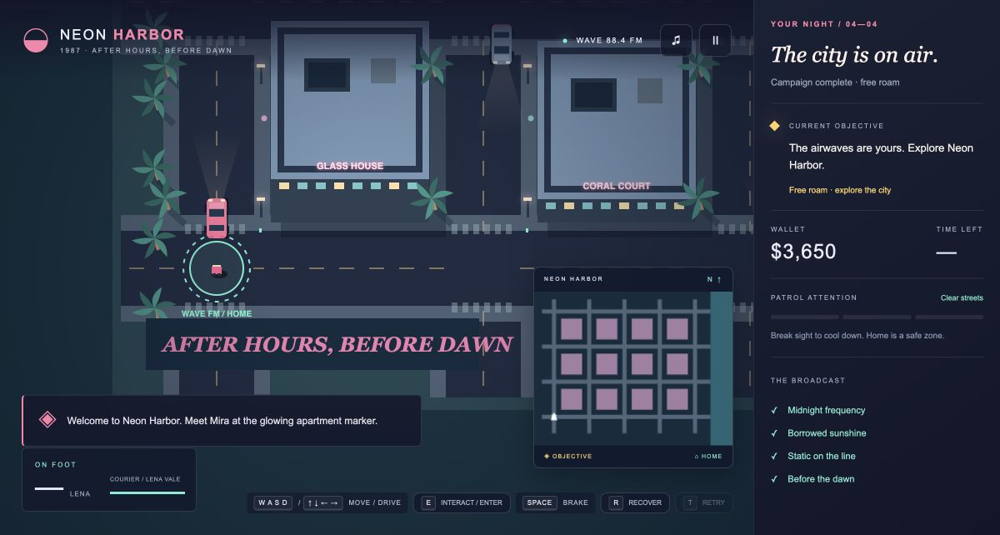
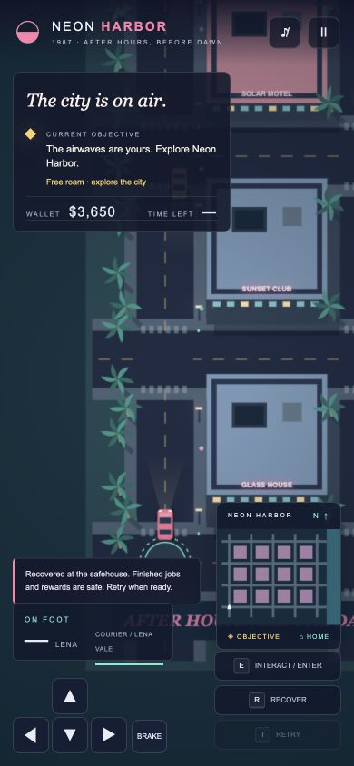
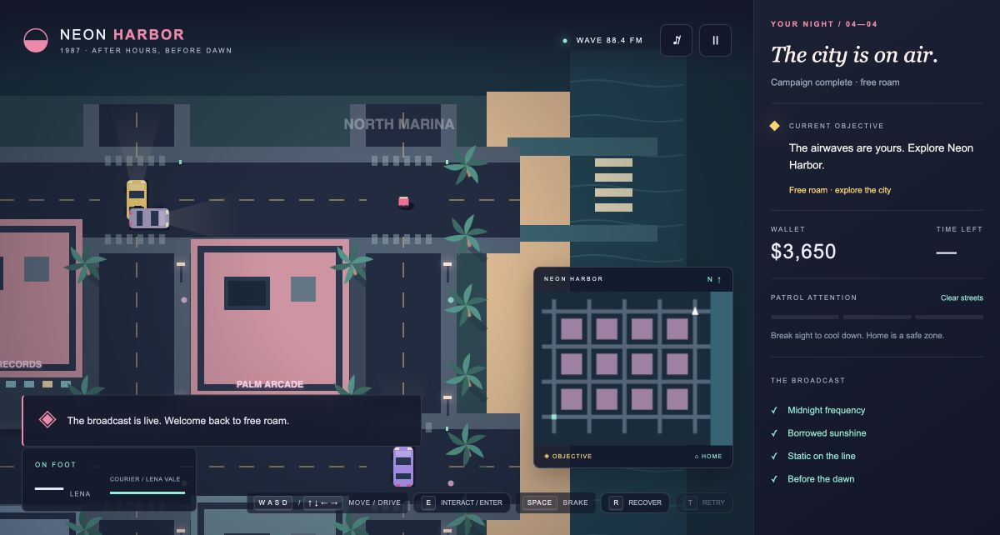
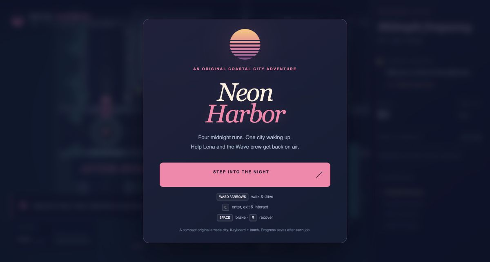

# Verification evidence

## Local and CI checks

18 public-behavior tests cover: walking and driving frame-rate variation (30/60/120 Hz), bounded world/building collision, braking/reverse, fast-exit refusal and clear exits, immutable observations, pause guards, invalid timesteps, traffic yielding, parked-car collision damage and exit separation, recovery/retry, mission timeout, exact reward totals, save version/corruption/forgery, new-campaign replay, fair patrol spawning and guaranteed safehouse cooling. The complete four-job campaign is navigated by public movement inputs and `interact`; there are no teleport/finish-job/testing commands.

Typecheck, formatting, production build and dependency audit passed. Production bundle is approximately 30 KB JavaScript and 11 KB CSS before gzip, with no runtime library or external assets. Node 24 on this Mac; CI uses Node 22. Exact remote revision and CI are recorded in the delivery response, rather than embedding a self-referencing SHA here.

## Mac Chrome visible campaign

Visible keyboard and pointer controls only; no browser state injection, storage editing or hidden completion commands:

- Started job 1, entered pink loaner, accelerated and braked, exited and delivered parts: **$450**.
- Accepted job 2, walked to marina, entered the specific Sunbird, reversed/steered/braked around traffic and patrol contact, returned it: **$1,150**. Collision and heat responses were observed. AI approach yielding was tightened after this run and covered by a red-green test.
- Activated relay, visibly saw patrol attention, broke sight by returning through city blocks, cooled at home and finished job 3: **$2,050**.
- Interrupted final job via Recovery, saw failure/Retry, restarted without reward loss; picked up tape, delivered to beach, escaped heat, returned home: **$3,650**, all four jobs checked off and free roam unlocked.
- In free roam, entered/accelerated/braked/recovered a car; reload restored completed progress and money. Pause stopped the city and ignored movement; settings changed mute and reduced motion and persisted on reload.
- Held directional inputs for multiple seconds throughout campaign, released/changed directions repeatedly, and exercised pointer press/release. Blur/visibility clearing is implemented; model pause/input guards are tested. A physical phone or exhaustive multi-touch cancellation matrix was not tested.

## Responsive and production preview

Chrome viewport **390×844**, no horizontal/vertical overflow (`scrollWidth=390`, `scrollHeight=844`). Direction-pad press and Interact entered the loaner; controls, minimap and objective stayed visible. This is pointer-based browser emulation, not physical-device validation. The desktop production preview was loaded after replacing the dev server; HTTP 200, browser assets and controls verified.

## Reviews and skills

Official Grill with Docs and Implement files were verified at mattpocock/skills on GitHub, plus local `/Users/intrepion/.agents/skills/{grill-with-docs,implement,grilling,domain-modeling,tdd,code-review}` and domain formats. No applicable project AGENTS.md existed; personal installed skill catalog was inspected.

Grill's interview confirmations and TDD seam confirmation were adapted to the user's explicit delegation of recommended choices/no design questions. The settled tree and criteria are in SPEC.md. Targeted red-green cycles: frame-independent walking, stale timer reset on load, and traffic yielding around stopped occupied vehicles. Other physics/campaign/save tests are regression/acceptance tests written after implementation; renderer/UI were tested visually, not claimed as TDD.

Independent parallel Standards and Spec reviewers used `9e082f6` as baseline. Standards reported no hard violations, with two maintainability suggestions (dense frame function; duplicate campaign constants). We extracted named input/HUD/persistence functions, formatted source, and derived rewards/length from JOBS. Spec found parked cars lacked collision response; bounded contact checks and a public-control regression now cover them. Follow-up reviewers check these fixes before final delivery.

## Limitations

A short coherent arcade city, not a commercial-scale remake. Top-down geometry, circular colliders, road-node patrols, lane traffic and synthesized audio are intentional. Pedestrians are decorative; no combat or injury. Progress saves only completed jobs and score, so reload abandons the current job safely. Money is a score rather than an economy. Mobile was checked in Chrome emulation; keyboard desktop is the primary play target. Session preview ends on logout/reboot/termination; restart with `npm start`. The repository folder is present, but sidebar project registration has no exposed supported control.

## Final production checks

Production preview was loaded at localhost after the build. Saved campaign state survived reload. Reset confirmation cancellation was verified through visible menu controls: one reset click, leave/reopen settings, unchanged $3,650 and restored New Campaign label. Then the supported two-click reset cleared test progress, settings were restored to sound enabled/reduced motion off, and reload showed a clean first-job welcome with $0. The play tab is retained as a deliverable. Browser logs showed extension warnings but no application-origin errors in the inspected results.

Detailed independent review disposition: [REVIEW.md](REVIEW.md).
